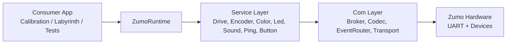

# Zumo.Library Docs

Kurzüberblick für externe Entwickler: Architektur, Kommunikationskern und zentrale Laufzeitabläufe in wenigen Minuten erfassen.

## Schnellstart

- Zweck: Zugriff auf Zumo-Hardware über klar getrennte Services und einen gemeinsamen Kommunikationslayer.
- Einstiegspunkt: ZumoRuntime baut Transport, Codec, Broker, EventRouter und Services zusammen.
- Kernkomplexität: Com-Bereich (Request/Response, Parsing, Event-Routing, Synchronisation).

## Dokumente

- [Architecture Overview](architecture-overview.md)
- [Com Focus](com-focus.md)
- [Communication Flows](communication-flows.md)
- [Component Collaboration](component-collaboration.md)
