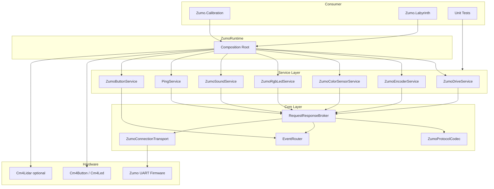

# Architecture Overview

## Aufgabe der Library

- Einheitliche API für Zumo-Hardwarefunktionen.
- Trennung von Fachservices und Kommunikationsdetails.
- Zentraler Runtime-Aufbau für Consumer-Anwendungen.

## Hauptbereiche

- Runtime: Objektaufbau und Lebenszyklus.
- Services: Fachliche API (Drive, Sensorik, LEDs, Sound, Button).
- Com: Transport, Protokoll, Korrelation, Event-Verteilung.
- Hardware-Abstraktionen: UART/GPIO/Lidar.

## Komponentenübersicht

## Einordnung des Com-Bereichs

- Alle Request/Response-Aufrufe der Services laufen durch den Broker.
- Ereignisbasierte Flows laufen über den EventRouter.
- Der Transport liefert rohe Zeilen, der Codec übersetzt in ProtocolFrames.

## Zentrale Klassen kurz erklärt

| Klasse                  | Kurzbeschreibung                                                           |
| ----------------------- | -------------------------------------------------------------------------- |
| ZumoRuntime             | Baut alle Kernkomponenten auf und stellt Services als zentrale API bereit. |
| ZumoDriveService        | Kapselt Fahrbefehle und Distanz/Speed-Abfragen.                            |
| ZumoEncoderService      | Liefert Encoder-Werte und Kalibrierfaktoren.                               |
| ZumoColorSensorService  | Liest Farbwerte und stellt Klassifikation bereit.                          |
| ZumoRgbLedService       | Setzt RGB-Farben für obere/untere LEDs.                                    |
| ZumoSoundService        | Sendet Sound-/Beep-Befehle.                                                |
| PingService             | Triggert und liest Ping-Distanzwerte.                                      |
| ZumoButtonService       | Reagiert auf Event-basierte Button-Zustandsänderungen.                     |
| RequestResponseBroker   | Korreliert Requests/Responses, verwaltet Pending-Requests und Timeouts.    |
| ZumoProtocolCodec       | Parst und formatiert das Wire-Protokoll (Address/Sdf/Payload/Type).        |
| EventRouter             | Verteilt eingehende Event-Frames an passende Subscriber.                   |
| ZumoConnectionTransport | UART-Transport mit Read-Loop und synchronisiertem Write-Zugriff.           |

Weiter mit Fokus auf Com: [Com Focus](com-focus.md)
