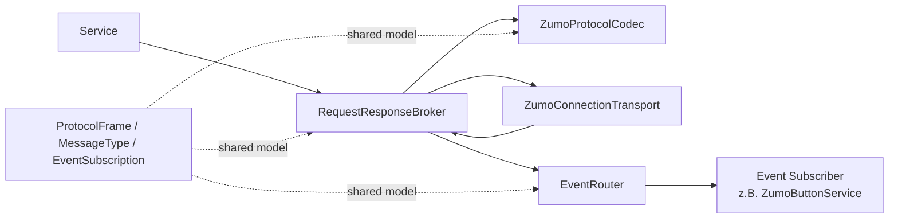
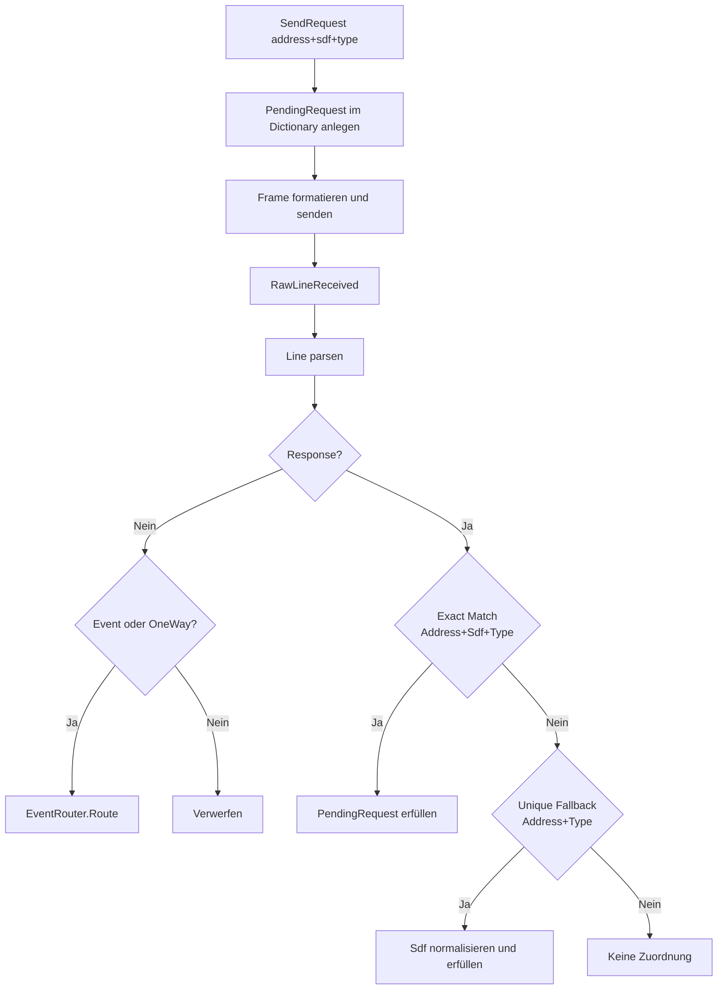
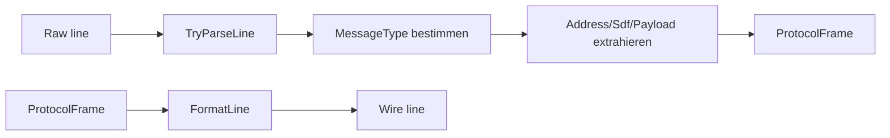

# Com Focus

## Verantwortung des Com-Bereichs

- Senden und Empfangen von Protokollzeilen über UART.
- Umwandlung zwischen Raw-Line und strukturierter Nachricht.
- Korrelation von Requests und Responses.
- Verteilung asynchroner Events an Subscriber.

## Bausteine und Rollen

## Request/Response-Organisation

## Klassen kurz erklärt

| Klasse                  | Kurzbeschreibung                                                                          |
| ----------------------- | ----------------------------------------------------------------------------------------- |
| RequestResponseBroker   | Zentrale Koordination von SendRequest/SendOneWay, Pending-Matching und Timeout-Verhalten. |
| ZumoProtocolCodec       | Übersetzt zwischen Raw-Line und ProtocolFrame inkl. Operator-Mapping.                     |
| ZumoConnectionTransport | Liest und schreibt UART-Zeilen, schützt den Reader-Thread vor Consumer-Fehlern.           |
| EventRouter             | Verwaltet Subscriptions und routed Event-Frames auf Handler.                              |
| ProtocolFrame           | Transportobjekt für Address, MessageType, Sdf, Payload und RawLine.                       |
| EventSubscription       | Definiert Filter für Event-Routing (Address/Type/Sdf).                                    |

## Parsing und Formatierung

| Operator | Bedeutung   |
| -------- | ----------- |
| ?        | GetRequest  |
| *        | GetResponse |
| >        | SetRequest  |
| <        | SetResponse |
| !        | Event       |
| :        | OneWay      |

## Synchronisation und Robustheit

- Broker schützt Attach/Detach und aktive Referenzen über Lock.
- Pending-Requests liegen in ConcurrentDictionary.
- Transport hat getrennte Locks für Zustand und Writes.
- Reader-Thread bleibt bei Consumer-Fehlern aktiv.

Weiter mit konkreten Laufzeitabläufen: [Communication Flows](communication-flows.md)
