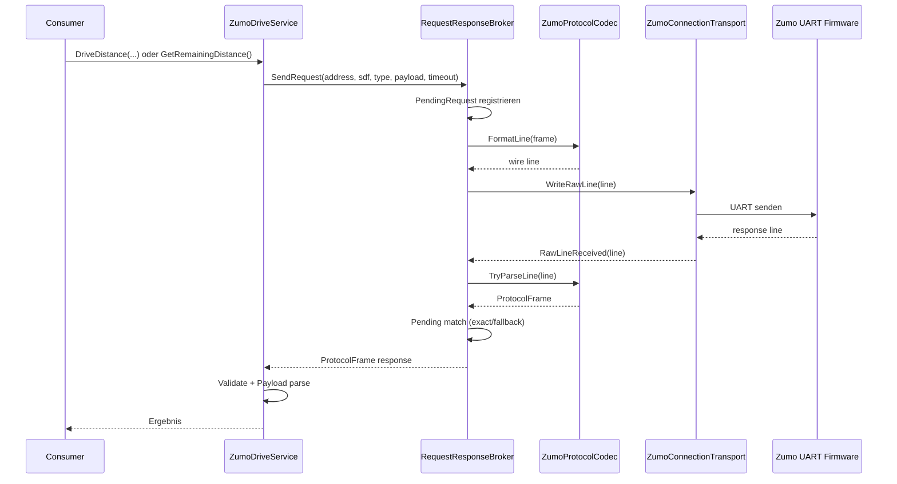
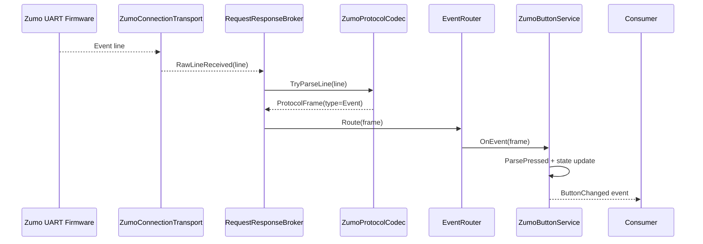
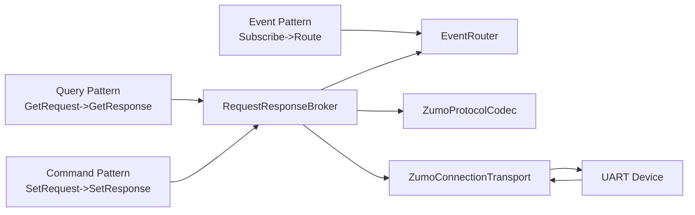

# Communication Flows

Diese Abläufe zeigen die wichtigsten realen Kommunikationspfade aus der aktuellen Implementierung.

## 1) Command/Query aus Service zur Hardware (Request/Response)

Beispiel: Drive-Service ruft SendRequest auf und wartet auf Antwort.

## 2) Asynchrones Event bis zum Service-Callback

Beispiel: Button-Event wird an ZumoButtonService weitergereicht.

## 3) Service nutzt Com-Muster (Query, Command, Event)

## Kerndatenfluss

- Service definiert Address, Sdf, Payload.
- Broker steuert Lebenszyklus der Anfrage.
- Codec übersetzt Wire-Format.
- Transport koppelt an UART und liefert eingehende Zeilen zurück.
- EventRouter bedient abonnierte Event-Handler.
