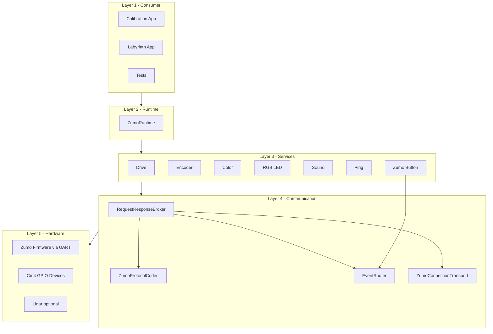

# Component Collaboration

## Schichtenbild

## Was jede Schicht leistet

| Schicht                 | Rolle                                                                               | Typische Klassen                                                                                                                  |
| ----------------------- | ----------------------------------------------------------------------------------- | --------------------------------------------------------------------------------------------------------------------------------- |
| Layer 1 - Consumer      | Nutzt die Library-API, enthält keine Kommunikationsdetails.                         | Calibration App, Labyrinth App, Tests                                                                                             |
| Layer 2 - Runtime       | Baut Abhängigkeiten auf und hält den gemeinsamen Lebenszyklus.                      | ZumoRuntime                                                                                                                       |
| Layer 3 - Services      | Kapselt fachliche Befehle/Abfragen pro Domäne.                                      | ZumoDriveService, ZumoEncoderService, ZumoColorSensorService, ZumoRgbLedService, ZumoSoundService, PingService, ZumoButtonService |
| Layer 4 - Communication | Löst technische Kommunikation: Serialisierung, Versand, Korrelation, Event-Routing. | RequestResponseBroker, ZumoProtocolCodec, EventRouter, ZumoConnectionTransport                                                    |
| Layer 5 - Hardware      | Stellt echte Sensor-/Aktorik-Endpunkte bereit.                                      | Zumo UART Firmware, Cm4Button/Cm4Led, optional Cm4Lidar                                                                           |

## Überlegungen hinter der Schichtung

- Entkopplung: Fachlogik bleibt in Services, Transportdetails bleiben im Com-Layer.
- Austauschbarkeit: Transport und Codec sind über Interfaces austauschbar und testbar.
- Fehler-Isolation: Timeouts/Korrelation zentral im Broker statt in jeder Service-Klasse.
- Event-Handling: Asynchrone Signale werden einheitlich über EventRouter verteilt.
- Wartbarkeit: Neue Hardwarebefehle werden primär in Services ergänzt, ohne Consumer-Code umzubauen.

## Koordinierend vs. spezialisiert

| Gruppe                  | Komponenten                                                                                                                                      |
| ----------------------- | ------------------------------------------------------------------------------------------------------------------------------------------------ |
| Koordinierend           | ZumoRuntime (Aufbau/Lebenszyklus), RequestResponseBroker (Tracking/Timeout/Korrelation), EventRouter (Routing)                                   |
| Technisch spezialisiert | ZumoProtocolCodec (Parsing/Formatierung), ZumoConnectionTransport (UART Read/Write), Services (Fachkommandos/Validierung/Payload-Interpretation) |

## Abhängigkeitsrichtung

- Consumer kennen primär Runtime oder Service-Interfaces.
- Services kennen den Broker oder EventRouter.
- Com kennt Transport/Codec/Protocol-Modelle.
- Hardwaredetails bleiben unterhalb der Service-API.

## Klassen kurz erklärt

| Klasse                  | Kurzbeschreibung                                                      |
| ----------------------- | --------------------------------------------------------------------- |
| ZumoRuntime             | Zentraler Builder für Com-Komponenten, GPIO-Komponenten und Services. |
| RequestResponseBroker   | Führt den Request-Lebenszyklus und die Response-Korrelation aus.      |
| ZumoProtocolCodec       | Kapselt das konkrete UART-Protokollformat.                            |
| EventRouter             | Verbindet Event-Frames mit den registrierten Handlern.                |
| ZumoConnectionTransport | Besitzt den UART Reader-Thread und den synchronisierten Schreibkanal. |
| ZumoButtonService       | Beispiel für Event-getriebenen Service auf Basis von EventRouter.     |

## Merksatz

Die Library ist schichtorientiert: fachliche API oben, Kommunikationskomplexität in der Mitte, Hardwarezugriff unten.
